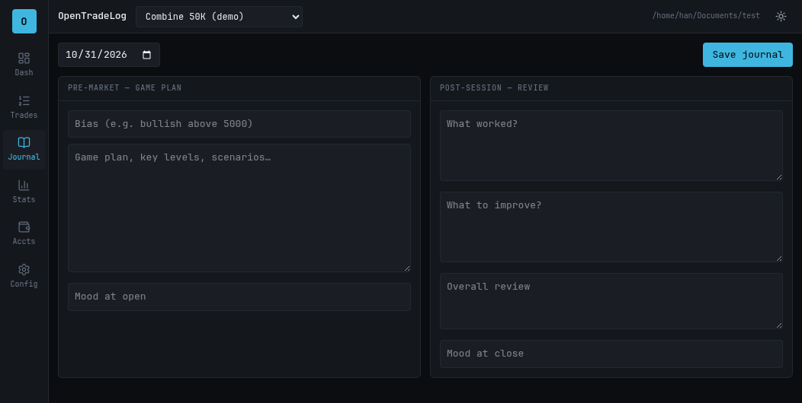
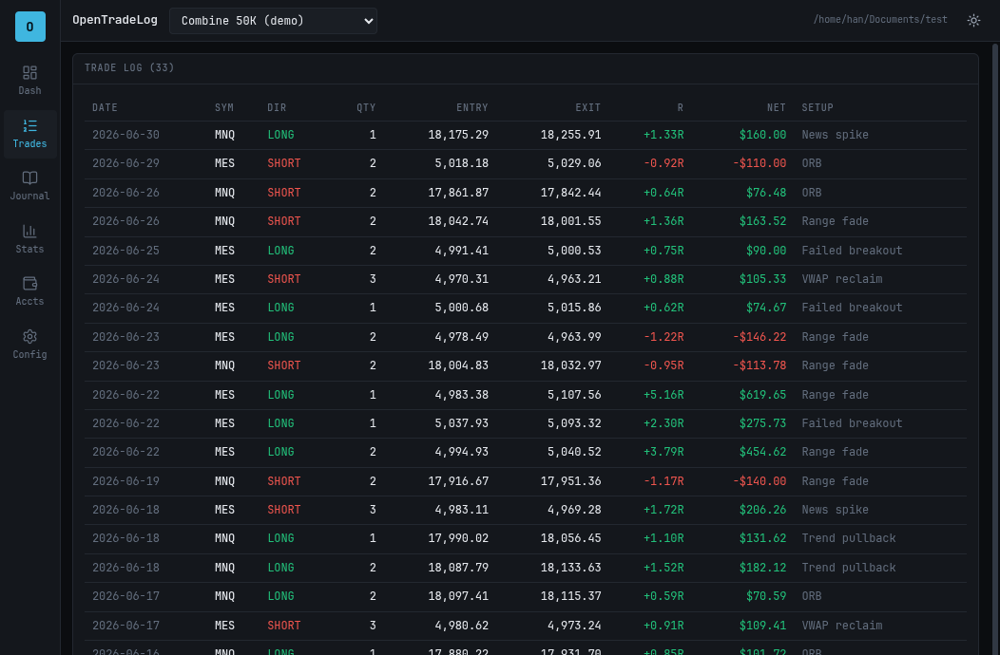
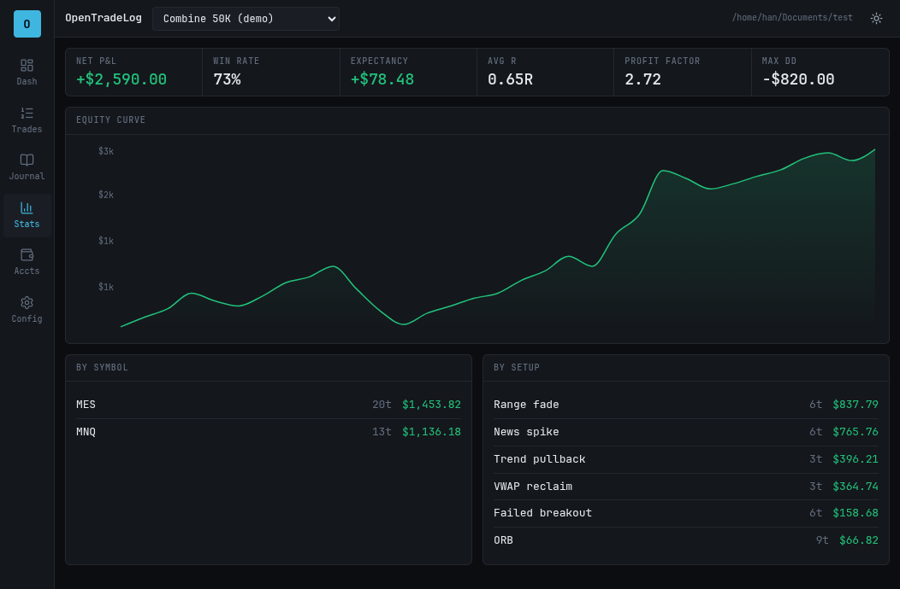

# OpenTradeLog

**An open-source, local-first futures trading journal for prop traders — built so your data outlives any app, and never locks you into one firm.**

Made for full-time futures traders (Topstep and beyond). Import your fills, get automatic round-trip trades, live prop-firm **guardrail meters**, trading **analytics + psychology**, and a daily **pre/post-market routine** — all in a fast, dark, keyboard-friendly desktop app.

> **Status:** early MVP. CSV import is fully working today; automated Topstep/ProjectX sync is planned (see Roadmap).

---

## 📸 Screenshots

| Dashboard (Guardrails & Equity Curve) | Daily Journal (Pre/Post-Market Routine) |
| :---: | :---: |
|  |  |

| Trade Log (Automatic Round-Trips) | Analytics (Expectancy & Performance) |
| :---: | :---: |
|  |  |

---

## 🛡️ Your data is yours — forever

This is the core design principle, not a footnote:

- **One portable folder ("the vault") that you own.** Everything lives there. Put it in Dropbox / iCloud / git to back it up. Nothing is hidden in app-internal storage, no cloud, no account, **no telemetry**.
- **Open, documented formats.** The working store is SQLite (an open, archival format). The app continuously **mirrors** every change to human-readable files:
  ```
  my-vault/
    journal.sqlite            # working store (open format)
    export/
      accounts.csv            # accounts + rule configs (canonical)
      executions.jsonl        # raw fills (canonical source of truth)
      trades.csv              # derived round-trip trades (USD)
      journal/<acct>/<date>.md# daily journals (Markdown + YAML)
      schema.md               # documented, versioned spec
      manifest.json           # schema version + export info
    attachments/              # screenshots as plain image files
  ```
- **Lossless round-trip.** Delete `journal.sqlite`, hit *Rebuild from vault files*, and the database is reconstructed identically from the exports. (This is covered by an automated test.)
- **Not a "Topstep app."** Topstep is one pluggable *rule profile*; a retail/no-rules profile ships too. Change firms, brokers, or go live — your journal continues unbroken.
- **MIT licensed & open source.** The tool is as ownable as the data — fork it, keep it, no one can sunset it.

---

## ✨ Features

- **Import** broker/TradingView fills via CSV → automatic **round-trip trade grouping** (handles scale-in/out and position flips).
- **Topstep guardrails**: trailing max-loss buffer (EOD for Combine, intraday for Express Funded), daily loss limit, profit target, and the 50%/40% consistency rule — as live dashboard meters with warn/breach states.
- **Analytics**: win rate, expectancy, average R-multiple, profit factor, equity & drawdown curves, and P&L by symbol / setup.
- **Journaling**: per-trade mood, discipline, rule-adherence, setup tag, notes, and planned-stop → automatic R-multiple.
- **Daily routine**: pre-market game plan + post-session review.
- **Design**: pro-terminal, dark-first, monospace tabular numbers, keyboard-friendly.

---

## 🛠️ Tech Stack

Electron · React · TypeScript · Vite · Tailwind CSS · Drizzle ORM + better-sqlite3 · Recharts. 100% local; the sync timer, SQLite, and (future) broker API key all live in the Node main process.

---

## 💻 Develop

```bash
pnpm install        # Node 20+ and a C toolchain required (better-sqlite3)
pnpm dev            # run the app
pnpm test           # unit + pipeline tests (Vitest)
pnpm build          # typecheck + production bundle
pnpm build:linux    # package (also :mac / :win)
```

---

## 🗺️ Roadmap

- **Phase 2 — Automated ProjectX/TopstepX sync** (requires Topstep's paid ProjectX API add-on): incremental pull, encrypted API key via Electron `safeStorage`, scheduled + on-demand sync.
- Chart/screenshot attachments UI & TradingView embeds, journal calendar heatmap, ⌘K command palette, more firm profiles (Apex, TakeProfit), CSV/PDF export, auto-update.

---

## 📄 License

[MIT](./LICENSE) © OpenTradeLog contributors
